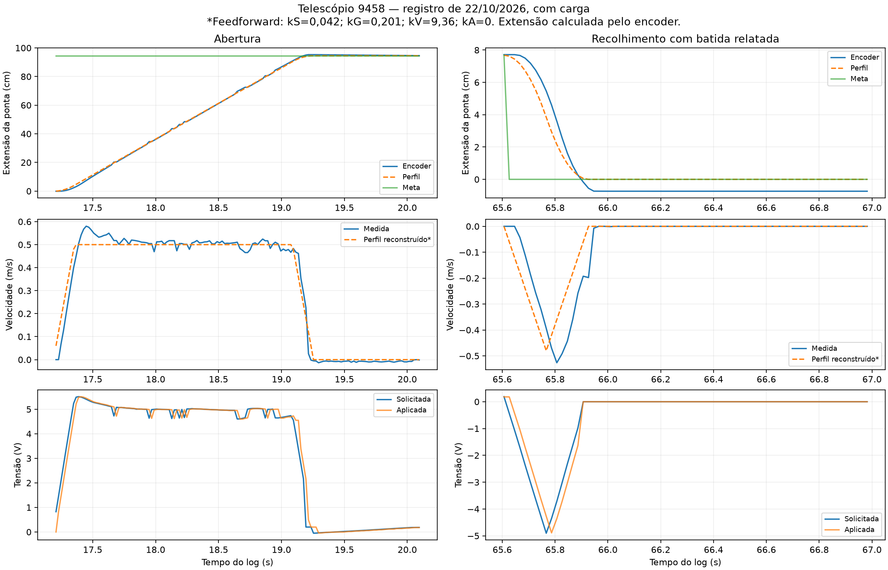

# Telescópio 9458 — análise do CSV e das batidas ao recolher

Fonte: `C:\Users\Admin\Desktop\2026-10-22_15-53-41\log.csv`, fornecido pela equipe.
Foram analisadas as 8.848 linhas do registro, com 601 colunas no arquivo original,
entre 13,058911 e 190,632629 s. A equipe confirmou mecanismo completo com carga,
trepidação e batida no recolhimento. O CSV original foi preservado.

## Conclusão sustentada pelo registro

O recolhimento chega rápido demais perto de zero. A margem de 5 cm protege a
abertura, mas não resolve a aproximação inferior. O perfil do ensaio usa cerca de
3 m/s², enquanto o código local revisado já usa 1 m/s² e uma zona de aproximação
lenta. Portanto, o CSV não valida o comportamento da configuração final do projeto.

| Evidência | Valor observado | Interpretação |
|---|---|---|
| Conversão posição | rotor × 0,0127 m/volta | Coerente em todas as amostras disponíveis |
| Conversão velocidade | rotor em voltas/s × 0,0127 | Coerente em todas as amostras disponíveis |
| Velocidade máxima medida | 0,5981 m/s | Não são 15–20 m/s de deslocamento linear |
| Feedback durante controle | 35 × erro do perfil, resíduo < 4e-15 V | Compatível com kP=35, kI=kD=0 |
| Perfil reconstruído | teto de 0,50 m/s, rampas de ±3 m/s² | Partidas e frenagens mais bruscas que a configuração local atual |
| Chegada inferior em 22,434938 s | 8,95 mm acima do zero, −0,408 m/s | Ainda recebe −3,65 V medidos na descida |
| Chegada inferior em 52,186541 s | 9,51 mm acima do zero, −0,422 m/s | Aproximação incompatível com um contato suave |
| Menor posição registrada | −9,97 mm em relação ao zero | Encoder passou da referência; não prova deslocamento físico através do batente |
| Leitura e envio CAN | `OK` em todas as linhas | Não foi registrada falha de comunicação nem reset de referência |
| Limite de estator | ativo em 3 amostras | Não explica sozinho a trepidação persistente |

A velocidade do perfil foi reconstruída do feedforward com kS=0,042 V,
kG=0,201 V, kV=9,36 V/(m/s) e kA=0, valores coerentes com as parcelas registradas.
As rampas de ±3 m/s² resultam de variações de 0,06 m/s por ciclo nominal de 20 ms.
As colunas de ganhos e da velocidade de referência estão vazias neste CSV; essa
reconstrução é uma inferência verificável, não uma leitura desses campos ausentes.

## Trepidação: o que se pode e não se pode afirmar

Em 918 amostras com velocidade absoluta maior que 0,05 m/s, há 37 repetições
consecutivas de posição (4,0%). No trecho de velocidade de referência constante,
a parcela de feedback varia até 0,455 V entre ciclos. A tensão aplicada mostra
perturbações correspondentes. Isso é compatível com irregularidade de atualização
das leituras e com correções do controle, além das partidas agressivas.

O CSV é uma exportação temporal de sinais e não informa a idade individual dos
pacotes CAN. As repetições não provam defeito do encoder. Tampouco o registro
separa folga, flexão, corrente/cabo, atrito variável e vibração mecânica. Não há
base para garantir que aumentar kP ou acrescentar kD resolverá a trepidação.

## Defeito de código reproduzido e corrigido

Em 106,390921 s, a meta era `1.734723475976807e-18` m. A condição
`goalMeters == 0` falhava, embora o operador estivesse recolhendo. Pouco depois,
a saída solicitada sobe para aproximadamente 0,33 V com posição negativa.

O código agora normaliza metas até 1 micrômetro para zero e usa a mesma tolerância
na proteção inferior. Um teste reproduz a meta e a posição exatas do CSV, confirma
saída zero depois do recolhimento e verifica que abrir novamente continua permitido.
Essa correção evita reenergização por arredondamento; a redução da velocidade de
chegada é uma proteção separada.

## Configuração final local

| Parâmetro | Configuração |
|---|---|
| Velocidade central | 0,55 m/s, aumento de 10% solicitado pela equipe |
| Aceleração e desaceleração do perfil | 1 m/s² |
| Aproximação aos extremos | 0,06 m/s nos últimos 0,03 m |
| Meta máxima de abertura | 0,94568 m, margem de 5 cm na ponta |
| Corte superior do Talon | 0,95568 m, reserva antes do batente de 0,99568 m |
| Meta inferior / corte reverso do Talon | zero |
| PID | mantido em kP=35, kI=0, kD=0; não declarado calibração final |
| Feedforward real | mantido: kS=0,042, kG=0,201, kV=9,36, kA=0 |

O aumento de velocidade vale para o trecho central. A 0,55 m/s, o perfil precisa
de aproximadamente 15,1 cm e 0,55 s para parar com desaceleração de 1 m/s².
Isso também se aplica ao soltar o gatilho no meio do curso.

O AdvantageScope recebeu tabela e gráfico com extensão física estimada e simulada
em cm e m, diferença e limites. Os números físicos usam o encoder sem limitar a
leitura ao desenho 3D. A redução continua 16:1, com voltas da saída publicadas.

## Como interpretar o print do SysId

O print mostra análise de feedback em **Velocity**, enquanto este código controla
**Position** no roboRIO. Não é correto copiar esses ganhos entre os dois tipos de
laço. A documentação da [WPILib sobre análise de ganhos](https://docs.wpilib.org/en/latest/docs/software/wpilib-tools/robot-characterization/analyzing-data.html)
também trata os ganhos sugeridos como ponto inicial, não ajuste garantido.

Se os sinais selecionados foram `Phoenix6/TalonFX-5/Position` e `Velocity`, neste
projeto eles estão em voltas e voltas/s do rotor. Rotular como metros não realiza
por si só a conversão correta. Por exemplo, 20 voltas/s correspondem a 0,254 m/s
na ponta; o kV do print, 0,11831 V/(volta/s), corresponderia a cerca de 9,32 V/(m/s).
Isso é compatível com a hipótese de escala incorreta no print, mas a seleção
original dos sinais e o arquivo `.hoot` não foram fornecidos para confirmação.

Use os campos já convertidos em metros listados em [SYSID.md](SYSID.md), conforme
a integração [CTRE/SysId](https://v6.docs.ctr-electronics.com/en/latest/docs/api-reference/wpilib-integration/sysid-integration/plumbing-and-running-sysid.html).
O CSV atual contém comandos de abrir/fechar e manutenção de posição. Não contém
os quatro estados de caracterização; não deve ser tratado como um novo ensaio
SysId nem receber estados de teste inventados.

R² de aceleração baixo limita a confiança em kA e nos ganhos de feedback derivados,
como explica a [WPILib sobre diagnósticos](https://docs.wpilib.org/en/latest/docs/software/advanced-controls/system-identification/viewing-diagnostics.html).
`kD=0` não significa ausência de todo amortecimento físico, nem prova a causa da
trepidação. Não foi aplicada a recomendação de kP=50–55/kD=3–4 presente na imagem.

## Verificação e próximo teste

A verificação completa local passou. Os testes incluem margem de operação,
aproximação em ambos os extremos com ganhos reais e atrasos de leitura de 20/40 ms,
falhas e reset do Talon, arredondamento do zero, rotinas SysId e publicação das
duas poses 3D, voltas, centímetros, metros e limites por NetworkTables.
Esses ensaios usam modelos e dispositivos substitutos, não o mecanismo físico.

Nenhum deploy nem acionamento foi feito nesta análise. Ao enviar o programa ao
9458, iniciar recolhido como procedimento da equipe e conferir no AdvantageScope
`Controle/Versao = APROXIMACAO_LENTA_ZERO_TOLERANTE_2`, velocidade 0,55,
aceleração 1,0 e aproximação 0,06. Validar primeiro deslocamentos curtos no meio
do curso. Antes de repetir recolhimento completo, conferir que a velocidade cai
ao entrar na zona final. Persistindo a trepidação, interromper e verificar a
transmissão/guia e registrar um novo `.wpilog` com esses parâmetros e sinais.
